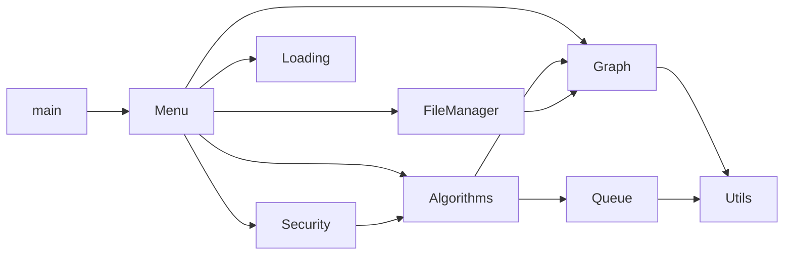

# Social Network Analyzer

A console application in C++ that models a social network as a graph. You can manage users and friendships, explore how people are connected, get friend suggestions, and scan for accounts that look unusual. All the data structures are implemented by hand, without the STL containers.

---

## Overview

People are vertices and friendships are edges. The program keeps this graph in memory, lets you edit it through a text menu, and answers questions about it: *Who is connected to whom? How many steps separate two people? Who should meet next? Which accounts behave oddly?*


| Module | Responsibility |
| ------ | -------------- |
| **Graph** | Stores users and friendships, validates every change |
| **Queue and algorithms** | A circular queue plus BFS, DFS, shortest path, components, mutual friends, recommendations and ranking |
| **Files, security and menu** | Saving and loading, the suspicious-account rules, the console interface |

---

## Features

**Users**
- Add, update and remove users (the ID never changes)
- Search by ID, name, city or profession, using partial text in any letter case
- Every field is validated the same way whether it comes from the keyboard or from a file

**Friendships**
- Add and remove friendships, list a user's friends
- Find the mutual friends of two users
- Self-friendships and duplicate friendships are rejected

**Graph analysis**
- Breadth-first and depth-first traversal from any user
- Shortest path between two users (degrees of separation)
- Connected components (the separate groups in the network)
- Friend recommendations: friends of friends ranked by mutual friends
- Ranking of all users by number of friends

**Safety checks**
- A security scan with four rules, with adjustable limits
- Loading that skips bad records and tells you exactly what was wrong

---

## Getting started

### Prerequisites

- A C++ compiler with C++11 support (`g++` from MinGW-w64 on Windows, or GCC / Clang on Linux and macOS)
- `make` is optional on Windows and recommended on Linux and macOS

### Build and run

The program is split over nine source files in `src/`, and **all of them must be compiled together**. Compiling `main.cpp` by itself fails because the code it calls lives in the other files.

**Windows, with the included scripts**

| Script | Purpose |
| ------ | ------- |
| `run.bat` | Builds `sna.exe` if it does not exist yet, then starts it. `run.bat rebuild` forces a rebuild |
| `build.bat` | Builds only |
| `test.bat` | Builds and runs every test program |

**Any system, with the compiler directly** (from the project folder):

```
g++ -std=c++11 -Isrc -o sna src/Utils.cpp src/Graph.cpp src/Queue.cpp src/Algorithms.cpp src/FileManager.cpp src/Security.cpp src/Menu.cpp src/Loading.cpp src/main.cpp
```

Run the result with `sna.exe` (Windows) or `./sna` (Linux and macOS).

**Linux and macOS, with make:**

```
make
./sna
```

Start the program from the project folder. It looks for its files in `data/` relative to where it is launched.

### First run

`data/` contains a small example network of 12 users and 12 friendships, which is loaded at startup. These steps show the main features:

| Menu choice | Expected result |
| ----------- | --------------- |
| 9, start at user `1` | Visiting order 1, 2, 3, 8, 4, 5, 6, 7, 11 |
| 11, from `1` to `11` | 5 degrees of separation, passing through users 3, 5, 6 and 7 |
| 11, from `1` to `9` | No path: user 9 is in a different group |
| 12 | 3 connected components |
| 13, user `1`, 3 suggestions | Hina Malik and Bilal Raza, 1 mutual friend each |
| 15, whole network | Flags for users 5, 9, 10 and 12 |

---

## Using the program

The main menu is grouped by purpose. After every action the screen waits for **Enter**, then clears and shows the menu again.

| Group | Choices |
| ----- | ------- |
| Users | **1** add, **2** search, **3** update, **4** remove (asks for confirmation) |
| Friendships | **5** add, **6** remove, **7** show a user's friends, **8** mutual friends |
| Analysis | **9** BFS, **10** DFS, **11** shortest path, **12** components, **13** recommendations, **14** ranking |
| Security | **15** scan one user or everyone, **16** change the rule limits and switches |
| Files | **17** save, **18** load (replaces what is in memory) |
| Exit | **0** quit, with an offer to save first |

On Windows a short row of dots plays after each choice and the screen is cleared between menus.

---

## How it works

### Data structures

| Structure | Source | Role |
| --------- | ------ | ---- |
| Singly linked list of users | `Graph.cpp` | Holds all users; appending at the tail is O(1) |
| Linked list of friends per user | `Graph.cpp` | One list for every user; each entry points straight to the friend |
| Adjacency-list graph | `SocialNetwork` | The two lists above, together |
| Circular queue | `Queue.cpp` | Powers BFS and shortest path |
| Bounds-checked growing array | `Utils.cpp` | Visited marks, parents, counters and result lists |
| Recursion | `Algorithms.cpp` | DFS and component labelling |
| Insertion sort | `Algorithms.cpp` | Ranking by friend count |

An adjacency list was chosen over a matrix because it needs memory proportional to the real friendships rather than to the square of the user count, and removing a user does not shift any other data. Every class that owns memory follows the Rule of Three, and the test suite runs clean under AddressSanitizer.

### Module relationships



### Running times

*V* is the number of users, *E* the number of friendships and *d* the friends of one user.

| Operation | Cost |
| --------- | ---- |
| BFS, DFS, shortest path, components | O(V + E) |
| Mutual friends | O(V + d) |
| Ranking | O(V²) worst case, O(V) when already sorted |
| Look up a user by ID | O(V) |

---

## Security rules

The scan reports patterns only, so every finding is worded as *potentially suspicious*. Whether an account is really a problem is a human decision.

| Rule | Condition | Default |
| ---- | --------- | ------- |
| R1 | The account has more friends than the limit | 50 |
| R2 | The account has no friends | enabled |
| R3 | Fewer than X% of its friends share a mutual friend with it (checked for users with 3 or more friends) | 20% |
| R4 | Two or more accounts use the same contact number | enabled |

Each finding states the rule, the value that was observed and the threshold it was compared with.

---

## Data files

Both files are plain text. Empty lines and lines beginning with `#` are skipped.

```
data/users.txt         id|name|age|city|profession|contact
data/friendships.txt   idA|idB
```

Example records:

```
1|Ali Khan|21|Karachi|Student|+923001234567
1|2
```

Accepted values: positive ID; name, city and profession of 1 to 50 characters without `|`; age from 13 to 120; contact number with an optional `+` and 7 to 15 digits.

Loading never stops at a bad line. Each rejected record is logged with its file, line number and reason, and a summary at the end lists records read, users loaded, friendships loaded and records rejected. A missing file is treated as an empty network.

---

## Project structure

```
.
├── run.bat, build.bat, test.bat   Windows helper scripts
├── Makefile                       build and test targets
├── data/                          users.txt and friendships.txt
├── src/
│   ├── Utils.h / .cpp             result codes, safe array, validators
│   ├── Graph.h / .cpp             users and friendships
│   ├── Queue.h / .cpp             circular queue
│   ├── Algorithms.h / .cpp        graph algorithms
│   ├── FileManager.h / .cpp       save and load
│   ├── Security.h / .cpp          security rules
│   ├── Menu.h / .cpp              console menu
│   ├── Loading.h / .cpp           dots animation and clear screen
│   └── main.cpp                   entry point
└── tests/                         six test programs and a small test helper
```

---

## Testing

Six independent test programs check normal behaviour and failure cases with a small custom `CHECK` macro, so no testing library is needed. In total there are 392 checks.

| Program | Covers |
| ------- | ------ |
| `test_graph` | users, friendships, removal, copying, the user limit |
| `test_queue` | wrap-around, full and empty queue, copying |
| `test_algorithms` | all graph algorithms, including a 1,000-user chain |
| `test_files` | saving, loading, malformed and missing files, the load report |
| `test_security` | each rule, thresholds, switches |
| `test_validation` | validators, parsing, string helpers, the safe array |

On Windows run `test.bat`. Elsewhere:

```
make test     # run all six programs
make asan     # run them again with AddressSanitizer to catch leaks and memory errors
```

---

## Troubleshooting

| Problem | Cause and fix |
| ------- | ------------- |
| No `sna.exe` appears | Only one file was compiled. Use `run.bat` or the full command above. The executable is created in the project folder, not in `src/` |
| `g++` is not recognized | The compiler is not installed or not on PATH. Install MinGW-w64 and open a new terminal |
| Saving reports a file error | The `data/` folder is missing or the program was started from another folder |
| A result vanishes immediately | The screen is cleared when you return to the menu. Press Enter only after reading it |
| No dots are shown | The animation uses a Windows call and is skipped on other systems |
| The same prompt keeps repeating | The input was rejected. Check the range, avoid `|` in text, and give phone numbers as digits with an optional leading `+` |

---

## Design notes

- Algorithms receive the network as `const` and only read it. Before each one runs, every user gets a temporary number (`tempIndex`, declared `mutable`) so ordinary arrays can act as visited, parent and counter tables.
- `Loading.cpp` is the only file that includes `<windows.h>`, guarded by `#ifdef _WIN32`. The rest of the code and all tests use only `<iostream>`, `<fstream>`, `<string>` and `<cstring>`.
- Security rule R3 reuses the mutual-friends function. That keeps it short but makes it slower than the other rules.

---

## Authors

Data Structures project, FAST-NUCES Karachi.

| Name | Roll number | Module |
| ---- | ----------- | ------ |
| *Member 1* | 25K-XXXX | Graph |
| *Member 2* | 25K-XXXX | Queue and algorithms |
| *Member 3* | 25K-XXXX | Files, security and menu |
